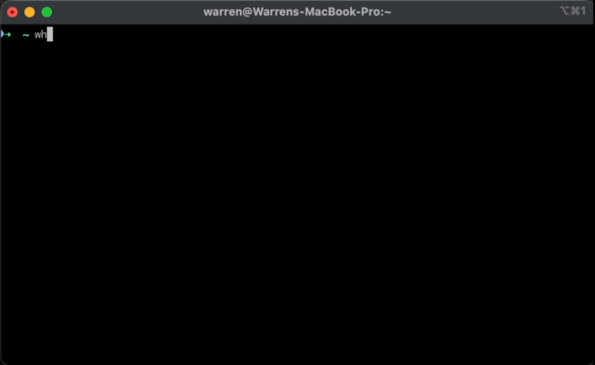

# whosup

See what's running on your ports, and stop it.
Because nobody remembers lsof -ti:8080 | xargs kill.

## Installation

`whosup` is available as a binary and on various package managers (eg. Homebrew).

### Homebrew

For macOS or various Linux distributions, Homebrew offers the simplest installation process. <a href="https://brew.sh/" target="_blank">If you do not have Homebrew installed, click here</a>.

```sh
brew install warrensbox/tap/whosup
```

To upgrade or remove it:

```sh
brew upgrade whosup
brew uninstall whosup
```

> **Note:** Homebrew on Linux needs at least Homebrew 5.0.6 to install casks.

## Usage

```sh
whosup                # interactive table
whosup -u             # only services you started (also --user)
whosup -p 8080        # show what's on one port (also --port)
whosup -p 8080 -q     # print only the PID(s) on that port (also --pid)
```



### Keys

| Key         | Action                      |
| ----------- | --------------------------- |
| `↑` / `k`   | Move up                     |
| `↓` / `j`   | Move down                   |
| `m`         | Show the row's full details |
| `r`         | Refresh the list            |
| `enter`     | Stop the selected service   |
| `q` / `esc` | Quit                        |

In the stop dialog, use `←` / `→` to choose, `enter` to confirm, or `y` / `n` as shortcuts. The dialog defaults to **No**.

## Notes

- `-u` / `--user` hides processes owned by other users and programs that ship with the OS (anything under `/System`, `/usr/libexec`, `/usr/sbin`, `/sbin`, `/usr/lib` or `/lib`). `-p` ignores it and always shows whatever is on the port.
- Without `sudo`, only your own processes are shown in full. Others may be missing or show `-`.
- Only TCP ports that are listening are shown. UDP isn't included.
