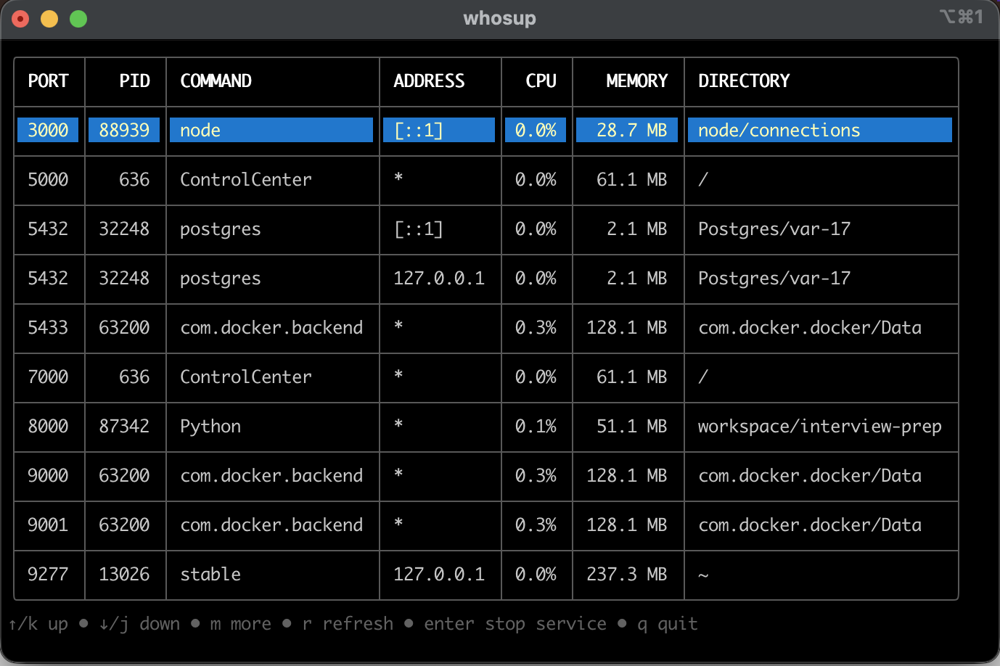

# whosup

See what's running on your ports, and stop it.
Because nobody remembers `lsof -ti:8080 | xargs kill`.

Pick a row, press `enter`, and confirm to stop it. See [Installation](installation.md) for other ways to install, and [Usage](usage.md) for every flag and key.
